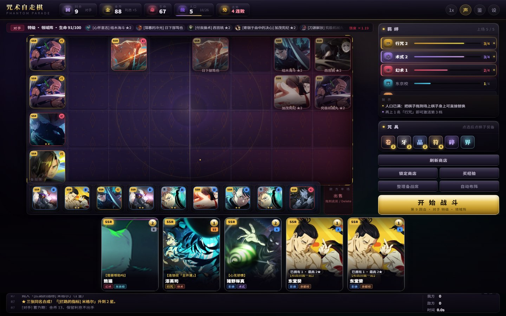
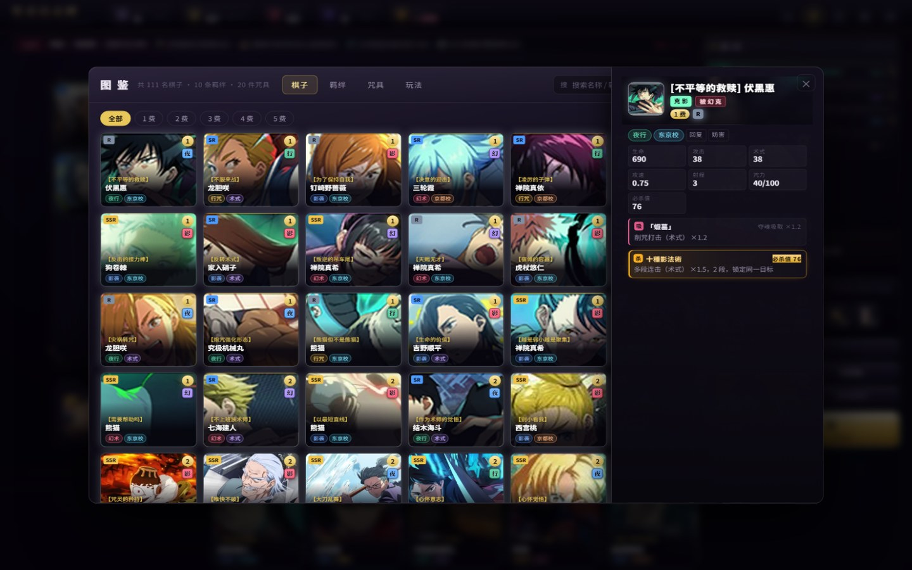
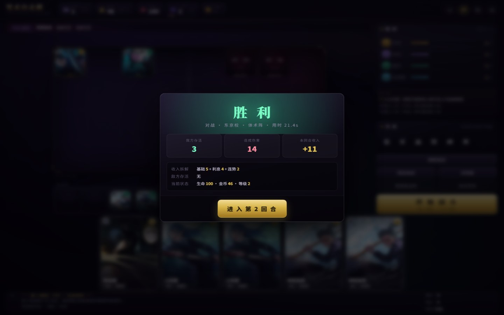
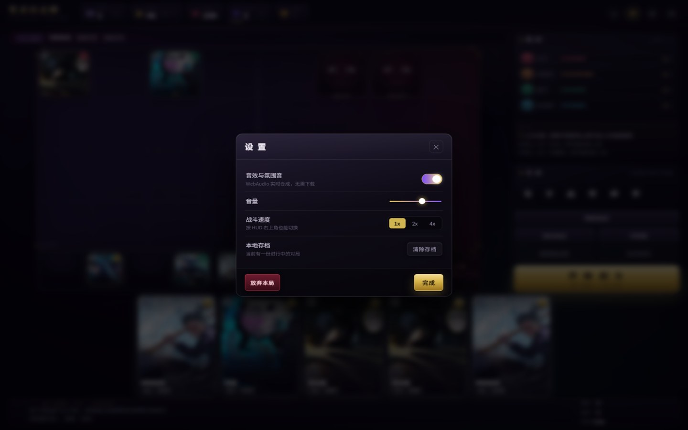
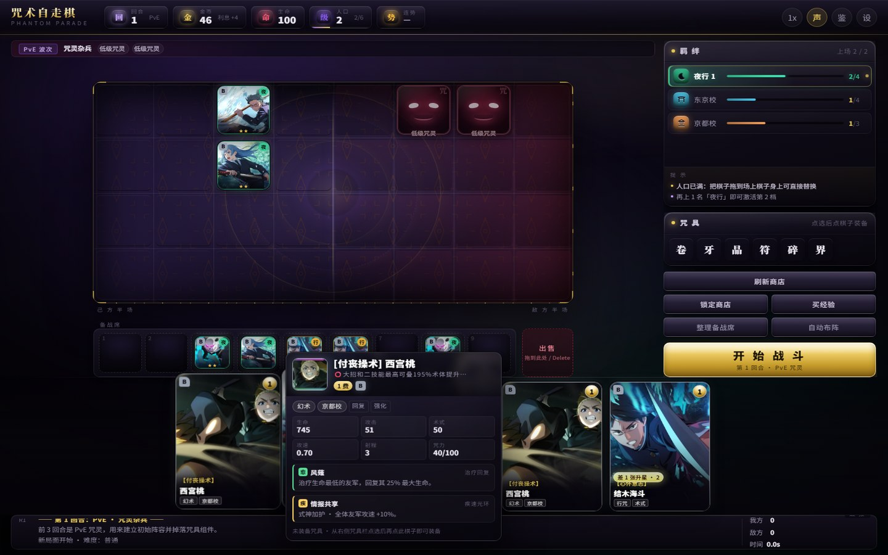
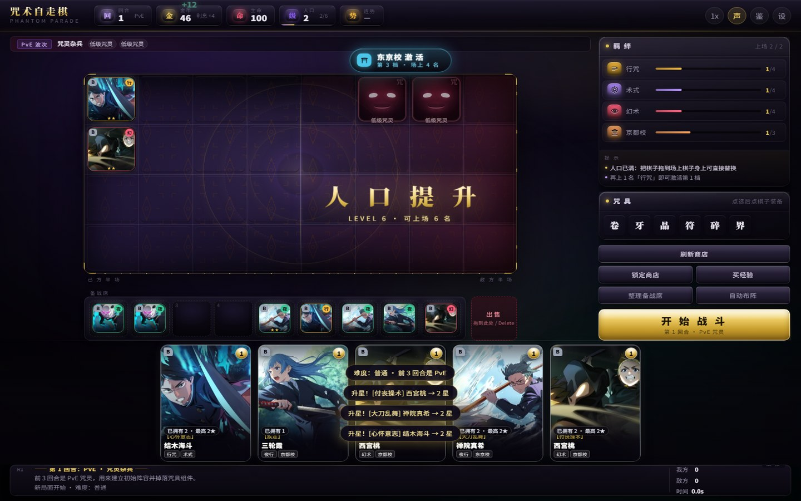
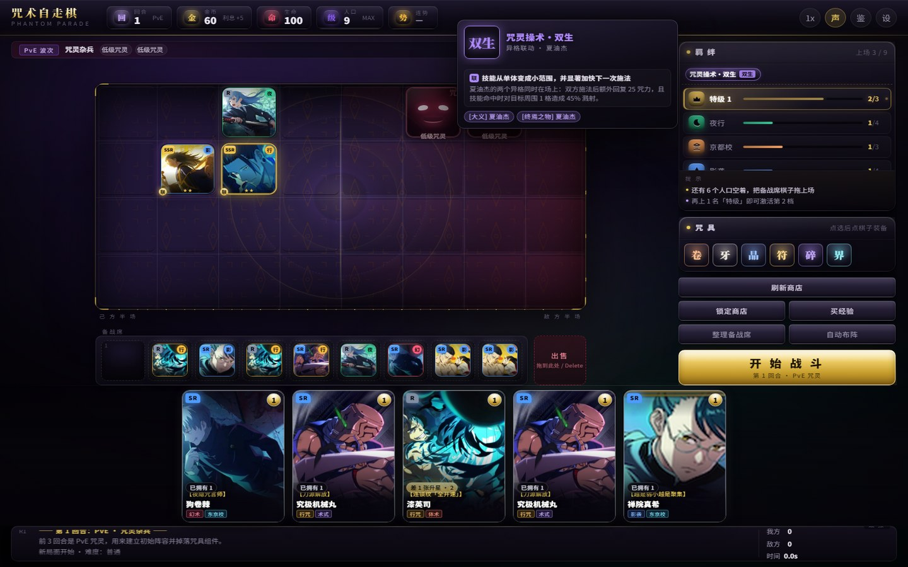

# 咒术回战：幻影夜行 · 自走棋 —— Web 重制版 v1.1

> 把原先用 Godot 4 做的同人自走棋（`..\咒术自走棋\`）**整套重做成网页版**。
> 规则、数值、羁绊、经济、AI 全部沿用并逐条对齐；**表现层彻底重写** —— 不再手绘 `_draw()`，
> 改用 DOM + CSS + WebAudio 做卡牌质感、拖拽反馈与战斗演出。

**纯静态网页，零依赖、零构建、双击即玩。**

---

## 1. 直接开始玩

```
双击  开始游戏.bat
```

或者直接双击 `index.html`（Chrome / Edge / Firefox 均可，本地文件协议即可运行，不需要服务器）。

> 如果你的浏览器有奇怪的安全策略不肯加载本地文件，用 `启动本地服务器.bat`，
> 它会用 Python 起一个 `http://127.0.0.1:8848` 的静态服务器，再打开页面。

---

## 2. 这个版本做成了什么样


| | |
|---|---|
|  |  |
| **备战阶段**：8×4 棋盘、9 格备战席、敌方阵容情报、羁绊实时统计 | **自动战斗**：血条/咒力条、飞行咒力弹、伤害跳字、黑闪、领域展开 |
|  |  |
| **图鉴**：111 名棋子全表（可搜索、按费用筛选、右侧详情抽屉、SSR/SR/R 品质徽记 + 强度档位） | **回合结算**：胜负、存活、伤害、收入拆解 |
|  |  |
| **悬停详情**：品质/星级/属性/技能/被动/已装咒具 | **设置**：音效、音量、战斗速度、存档管理 |

---

## 2.5 Phase 7 · UI 灵动化（2026-10 视觉重制）

> 目标：摆脱「网页 Demo」感，对齐《云顶之弈》《金铲铲之战》一类的商业表现。
> 技术依据见 [DESIGN_RESEARCH_UI.md](DESIGN_RESEARCH_UI.md)。

| | |
|---|---|
|  |  |
| **卡牌悬停**：3D 倾斜 + 光泽跟随指针 + 品质色外发光 + 购买条上浮 | **变强感知**：羁绊激活横幅 + 金币漂浮 +「人口提升」全屏横幅 |

- **材质**：面板改成三层叠加 + 渐变描边（`mask-composite` 只描边不填充）+ 三层阴影（近锐利/远弥散），
  顶栏与按钮有内凹外凸的金属分层。
- **卡牌**：`cubic-bezier(.34,1.56,.64,1)` 的弹性上浮、指针驱动的 `--rx/--ry` 倾斜与 `--mx/--my` 光泽、
  立绘与底板三层渐隐过渡；名字拆成「金色异格前缀 + 白色本体名」两行，杜绝省略号截断。
- **打击感**：跳字走弧线（水平漂移 + 抬升 + 随机旋转），命中叠加白闪/冲击环/火花粒子，
  技能额外有十字星芒，黑闪有径向爆闪 + 110ms 顿帧；粒子走 Canvas 对象池。
- **变强感知**：羁绊激活整行炸光 + 药丸横幅；金币数字弹跳 + 漂浮增量；升级有全屏横幅。
- **羁绊图标**：手绘 SVG 图标集（`js/ui/icons.js`，10 个，离线可用），替换原来的纯文字首字。
- **棋盘**：SVG 符纹底纹 + 中心竞技场打光 + 敌方半场红调压暗 + 常驻咒力浮尘粒子。
- **性能**：粒子对象池（260 预分配）、DOM 特效节点自杀定时器、`backdrop-filter` 只用在 3 个主面板。

`?dev=hover` / `?dev=banner` / `?dev=late&r=9` / `?dev=late-battle&r=9&t=4` 可以直接复现这几张验收图。

---
## 2.6 异格联动与品质（P0）



同一角色的**两个异格同时上场**时触发隐藏协同。三组联动改的都是**技能机制**：

| 联动 | 成员 | 机制改动 |
|---|---|---|
| 咒灵操术・双生 | [大义] 夏油杰 + [终焉之物] 夏油杰 | 施法额外回 25 咒力；技能命中对目标周围 1 格 **溅射 45%**（单体变范围） |
| 最强的两人 | [觉醒] 五条悟 + [最强] 五条悟 | 开战 4 秒**不可被选取** + 攻击必中；每场首次施法后**立刻再放一次**（60% 威力） |
| 容器与诅咒之王 | [宿傩的容器] 虎杖 + [真正的咒术] 两面宿傩 | 虎杖**受击叠层**（+5% 攻击/层，上限 8 层）；宿傩**击杀回 25% 生命**；虎杖阵亡则宿傩**立刻充满咒力** |

- 场上激活时：棋盘棋子带金色「联」标记，羁绊面板顶部出现联动条（悬停看详情）
- 开战时播报「异 格 联 动」横幅
- **品质**：SSR / SR / R 按原作裁定，商店卡、图鉴、详情卡都显示品质徽记

---
## 3. 相比 Godot 版，保留了什么、改了什么

### 3.1 完整保留（逐条对照移植，未改数值）

| 模块 | 内容 |
|---|---|
| 数据 | **111 名棋子全部实装**（40 个本体角色 / 30 组异格）、**10 条羁绊 / 28 个档位**、**10 件咒具**、**5 组异格联动**、**81 张带必杀技**、3 波 PvE、3 套 AI 阵容蓝图 |
| 棋盘 | 8×4，玩家占左侧 4 列；人口上限 = 等级；**人口满时拖到棋子身上可直接替换** |
| 经济 | 起始 6 金 / 2 级；每回合基础 5 金 + 利息（每 10 金 +1，上限 5）+ 连势查表（3–4 连 +1 / 5 连 +2 / 6 连以上 +3）+ **PvP 胜利 +1**；出售按 1★/2★/3★ = 1×/3×/9× 费用，**非「1 费 1 星」少返 1 金**；刷新 2 金、买经验 4 金、锁定免费；升级经验阶梯 `0,2,6,10,16,26,38,52,70,92` |
| 商店 | 5 格、等级概率表、共享卡池（1 费 18 张 … 5 费 6 张） |
| 升星 | 同名 3 张 → 2★，再 3 张 → 3★；生命 ×1.75 / ×3，攻击与术式 ×1.49 / ×2.1 |
| 品质 | **R / SR / SSR** 取自官方强度榜的标注（无前缀=SSR、`SR`/`R` 前缀=对应品质），实际分布 91 / 11 / 9 |
| 强度档位 | SSS / SS / S / A / B / C 取自官方强度榜，**独立于品质与费用**，卡面与详情都会显示 |
| 属性克制 | **行→幻→夜→影→行** 四属性首尾相衔，克制 +20% / 被克 −10% |
| 必杀技 | 每张卡有独立必杀槽（由原作必杀值换算），81 张卡带必杀 |
| 异格联动 | 同本体的两个异格同时上场触发隐藏协同，**改的是技能机制**而不是纯数值（共 5 组） |
| 出售 | 返还 = 费用 × 1/3/9（1/2/3★）；≥4 费或 ≥2★ 二次确认；咒具退回背包 |
| 咒具 | 每棋子 3 件；两件组件自动合成成装；可随时卸下（右键棋子卸最后一件） |
| 羁绊 | 10 条 28 档全部在战斗引擎里真实生效（降蓝、背刺、分身、侵蚀、领域、反击…） |
| 战斗 | 8×4 网格、按攻速出手、射程内打最近敌人否则移动；11 种被动；30 秒加时（递增真伤）、45 秒强制判定 |
| PvE | 前 3 回合咒灵波次，胜利掉落 2 件组件 + 2 金 |
| AI | 真实经营金币，储蓄 → 转型 → 冲刺三阶段；三档难度只改 AI 经济与搜卡力度，不改棋子数值 |
| 难度 | 简单 / 普通 / 困难 |
| 异格 | 同一角色的不同卡面是**独立棋子**（费用、元素、技能全不同） |

### 3.2 重做的地方（这才是"移植到网页"的意义）

**视觉**

- 全局氛围层：缓慢漂移的咒力雾、暗角、颗粒噪点、顶部极光 —— 画面有景深，不再"平铺"。
- 卡牌：品质色同时出现在描边 / 外发光 / 角标 / 内高光；悬停 3D 倾斜 + 斜扫高光；SS 卡常驻虹彩。
- 棋盘：领域阵法底纹、中线光带、四角钢金装饰、内投影纵深；棋子带元素色地光与投影。
- 棋子令牌：立绘 + 品质角标 + 元素徽记 + 星级 + 咒具小点；战斗中叠加血条 / 咒力条 / 护盾条。
- PvE 咒灵没有立绘，用**纯 CSS 程序绘制**的咒灵面具（随时间呼吸的咒力晕、发光双眼、獠牙口）。
- 1080p / 900p / 720p 三档自适应，窗口缩放自动重排（`--cell` 由 JS 按可用空间计算）。

**交互**

- 拖拽：原位留虚影 + 虚线框，跟随指针的是**放大 1.12 倍克隆体**（带名字牌、呼吸光晕、投影）。
- 落点四色语言：**绿 = 空位 / 紫 = 替换或互换 / 橙 = 人口已满 / 红 = 非法（敌方半场）**。
- 点击 A → 点击 B 自动互换（一上一下时）；都在场上只切换选中。
- **双击**备战席棋子自动上场；**Delete** 卖掉选中棋子；**1–9** 选中备战席第 N 格。
- 备战席 / 商店 / 战斗快捷键：`空格` 开战、`R` 刷新、`L` 锁店、`F` 买经验、`C` 图鉴、`Esc` 取消。
- 敌方半场实时显示**对手阵容情报**（灰色令牌 + 名字 + 星级，可悬停看详情），备战阶段就能针对性布阵。
- 右栏"提示"区会根据当前局面给出下一步建议（还差 1 名激活羁绊 / 再买一张就升星 / 金币该攒利息了…）。
- 商店卡、羁绊条目、咒具、棋子全部有富文本悬停详情（位置自动避让视口边缘）。

**战斗演出**

- 伤害跳字（普通 / 技能 / 治疗 / 闪避 / 免疫 各自配色与字号）、受击闪白与抖动、攻击前冲。
- 远程单位飞咒力弹（真实插值飞行）、近战挥砍弧光、技能名浮字、施法冲击环。
- 黑闪：白核红爆 + 震屏 + 低频轰鸣。
- 领域展开：全屏阵法扩散 + 棋盘发光 + 横幅 + 深空音效。
- 加时：横幅 + 红色脉冲条 + 警告音。
- 升星：金色扩散环 + 星字上飘 + 震屏；咒具合成：同款特效 + 音效。
- 掉血：全屏红色暗角脉冲 + 震屏。

**其它**

- **WebAudio 实时合成音效**（点击/购买/装备/升星/命中/黑闪/施法/领域/胜负…）+ 极低音量环境氛围层，**不需要任何音频文件**，可在设置里关掉。
- **本地存档**：每回合结束与每 20 秒自动存到 `localStorage`，标题页可"继续存档"。
- 战斗速度 1× / 2× / 4×，固定步长 `1/60` 推进，不同刷新率下结果一致。

### 3.3 顺手修掉的 Godot 版遗留 bug

| 问题 | 处理 |
|---|---|
| AI 的"橡皮筋"强度补偿把 `player_hp` 写死成 100，实际上从未生效 | 改为按 **AI 自己剩余生命**追赶：AI 落后才变强，玩家落后不再被叠加惩罚（避免掉血后一路雪崩） |
| AI 摆位在人数多时会把两个单位放在同一格 | 摆位改为"抢占最近空格"，保证一棋一格 |
| 夜蛾正道的"指导"临时加攻**没有回退**（`buff_timer` 从未被读取） | 6 秒后正确回退 |
| 右边栏商店详情区面积大且经常空白 | 换成"羁绊统计 + 行动提示 + 咒具背包"的复合面板 |
| 商店/日志高度变化会挤压棋盘导致重叠 | 用 `ResizeObserver` + 0.4s 自愈轮询重新计算格子尺寸 |

**难度曲线也重新标定过**：写了一个"会看羁绊、会留利息、会冲星"的机器人做批量对局（`tools/balance.mjs`），
按 20 局样本把三档难度调到 **简单 ≈ 80% / 普通 ≈ 40% / 困难 ≈ 20%** 的胜率（机器人水平，人类玩家通常更高）。

---

## 4. 一局怎么打

1. 前 **3 回合**是 PvE 咒灵，白给金币和咒具组件，用来搭初始阵容。
2. 第 4 回合起对阵 AI 对手，双方各 100 生命。
3. 每回合收入 = 基础 5 + 利息 + 连势奖励；输掉回合按敌方存活人数扣血：`2 + 存活数×2 + 回合数/3`。
4. 常规思路：**攒 50 金吃满利息 → 升人口 → 搜卡凑羁绊 / 冲 3 星 → 冲刺**。
5. 任意一方生命归零即结束。

### 操作速查

| 操作 | 效果 |
|---|---|
| 点击商店卡片 | 购买，进备战席 |
| 拖动 备战席 ↔ 棋盘 | 上场 / 换位 / 互换 |
| 拖到右下角「出售」 | 卖出（高费/高星二次确认） |
| 点击 A → 点击 B | 一上一下互换；都在场上只切换选中 |
| 双击备战席棋子 | 自动上场 |
| 右键棋子 | 卸下最后一件咒具 |
| 点咒具 → 点棋子 | 装备；两件组件同装会自动合成 |
| `Delete` | 卖掉选中的棋子 |
| `空格` | 开始战斗 / 进入下一回合 |
| `R` / `L` / `F` | 刷新 / 锁定 / 买经验 |
| `1`–`9` | 选中备战席第 N 格 |
| `C` / `Esc` | 图鉴 / 关闭弹窗与取消选择 |

---

## 5. 目录结构

```
咒术自走棋v1.1/
├── index.html               # 单页入口（唯一的 HTML）
├── 开始游戏.bat              # 双击即玩
├── 启动本地服务器.bat         # 需要 http:// 时的备用方案
├── README.md
├── docs/                    # 截图
├── data/
│   ├── game-data.js         # 自动生成的数据包（window.JJK_DATA）
│   └── raw/*.json           # 原始数据副本（改完跑 tools/build_data.py 重新生成）
├── assets/
│   ├── units/<id>.webp      # 111 张头像（256×256）
│   ├── cards/<id>.webp      # 111 张卡面（240×336，缺卡面的用头像合成）
│   └── grain.webp           # 全局颗粒层
├── css/
│   ├── tokens.css           # 设计变量（色板/字体/间距/圆角/阴影/动效）
│   ├── base.css             # 复位 + 氛围层 + 按钮/面板/标签
│   ├── layout.css           # 顶栏/舞台/商店坞/日志坞 + 响应式
│   ├── board.css            # 棋盘/格子/令牌/咒灵/备战席/战斗特效
│   ├── cards.css            # 商店卡/羁绊条目/咒具/拖拽残影/详情浮层
│   ├── panels.css           # 装备槽/背包/提示
│   ├── overlays.css         # 标题页/结算/图鉴/设置/弹窗
│   └── anim.css             # 全部关键帧
├── js/
│   ├── core/
│   │   ├── util.js          # DOM/数学/随机/事件总线/帧循环/补间
│   │   ├── data.js          # 数据索引 + 展示元数据（品质/元素/技能/被动/咒具）
│   │   ├── battle.js        # 自动战斗引擎（移植自 battle.gd）
│   │   ├── ai.js            # AI 对手（移植自 ai_opponent.gd）
│   │   └── game.js          # 局内状态机（移植自 main.gd 的业务逻辑）
│   ├── ui/
│   │   ├── widgets.js       # 令牌/星级/咒具/羁绊标签/列表协调
│   │   ├── audio.js         # WebAudio 合成音效 + 环境氛围
│   │   ├── fx.js            # 跳字/打击/震屏/横幅/升星
│   │   ├── tooltip.js       # 富文本详情浮层
│   │   ├── board.js         # 棋盘渲染 + 拖拽 + 情报层
│   │   ├── shop.js          # 商店卡
│   │   ├── panels.js        # HUD/羁绊/咒具/日志/情报/提示
│   │   ├── battleview.js    # 战斗表现层
│   │   ├── codex.js         # 图鉴
│   │   └── screens.js       # 标题/结算/终局/设置/确认框
│   └── main.js              # 总装：接线、主循环、快捷键、自适应
└── tools/
    ├── prepare_assets.py    # 立绘 → WebP
    ├── build_data.py        # JSON → game-data.js
    ├── selftest.mjs         # 纯逻辑自测（39 项）
    ├── e2e.js               # 浏览器交互自测（25 项）
    └── balance.mjs          # 难度曲线批量对局实验
```

---

## 6. 开发与自测

### 重新生成资源 / 数据

```powershell
# 立绘与卡面 → assets/（需要 Pillow）
python tools\prepare_assets.py

# data/raw/*.json → data/game-data.js
python tools\build_data.py
```

### 逻辑自测（Node，39 项）

```powershell
node tools\selftest.mjs
```

覆盖：数据完整性、羁绊档位无死重、经济与利息、锁定商店、人口上限、敌方半场拦截、
9 张同名合成 3★、两件组件合成成装且背包净减 2、领域只触发一次、黑闪可触发、
三档难度各 20 回合全自动对局无异常、AI 摆位不重叠、存档读档。

### 浏览器交互自测（28 项）

```powershell
# 生成注入了测试脚本的临时页
$html = Get-Content index.html -Raw
$html.Replace('</body>', '<script src="tools/e2e.js"></script></body>') | Set-Content _e2e.html

# 用无头浏览器跑（结果写在 <title> 里）
msedge --headless=new --allow-file-access-from-files --window-size=1464,992 `
       --virtual-time-budget=30000 --dump-dom "file:///$PWD/_e2e.html"
```

覆盖：购买扣金、拖拽上场、人口满时替换、敌方半场拒绝、拖到出售区卖出、装备与合成、
右键卸下、点击互换、图鉴开关、开始战斗、战斗结束、进入下一回合。

> 最近一次结果：**逻辑 39/39 通过，交互 28/28 通过。**

### 调试用的 URL 开关

| 参数 | 作用 |
|---|---|
| `?dev=deploy` | 直接开局并自动铺场（截图用） |
| `?dev=late&r=9` | 快速推进到第 9 回合，看满人口 + 满羁绊观感 |
| `?dev=battle&t=6` | 直接开战并快进到第 6 秒 |
| `?dev=codex` / `codex-traits` / `codex-items` / `codex-rules` | 直接打开对应图鉴分页 |
| `?dev=result` / `gameover` / `settings` / `tooltip` | 直接打开对应界面 |

---

## 7. 技术要点

- **零依赖零构建**：没有 npm / 打包器 / 框架。全部是普通 `<script>`（经典脚本，非 ES module），
  所以 `file://` 直接双击就能跑 —— 这是刻意选择，交付物不应该要求玩家先装 Node。
- **逻辑与渲染分离**：`battle.js` 是纯逻辑模拟器，只产出事件数组；`battleview.js` 消费事件做演出。
  战斗以固定步长 `1/60` 推进，渲染帧率不影响结果。
- **DOM 复用**：棋盘令牌、羁绊行、商店卡都做 key 级复用（`Widgets.reconcile`），
  位置用 `transform: translate3d(百分比)` 驱动，移动/交换天然有过渡。
- **自适应**：JS 按 `stage` 的可用宽高算出 `--cell` / `--slot`，CSS 全部用这两个变量推导，
  所以任何 16:9 分辨率下棋盘、备战席、商店都能对齐。
- **无障碍/性能**：尊重 `prefers-reduced-motion`；跳字与特效节点用完即删，不留在 DOM 里。

---

## 8. 已知限制

1. 仅适配**桌面浏览器**（≥ 1180×700）。手机竖屏未做专门布局，暂不建议。
2. 技能表现仍是"通用模板 + 特效配色"，没有给每个角色写独立机制（如五条悟的"无下限"）。
3. AI 只有一个对手，排名固定 1/2 名，没有 8 人局与轮转对战。
4. 数值只做过"能分胜负、时长 15–30 秒"级别的粗调，没有胜率矩阵级别的平衡。
5. 存档只存本地（`localStorage`），清浏览器数据会丢。

---

## 9. 声明

非商业同人作品。角色与世界观版权归 **芥见下下 / 集英社 / 东宝 / サムザップ** 所有。
棋子数值与技能文本参考 **gamekee《咒术回战 幻影夜行》** wiki 的公开资料，仅用于本项目的机制设计；
立绘/卡面同样来自该站公开资源，仅作同人演示用途。
